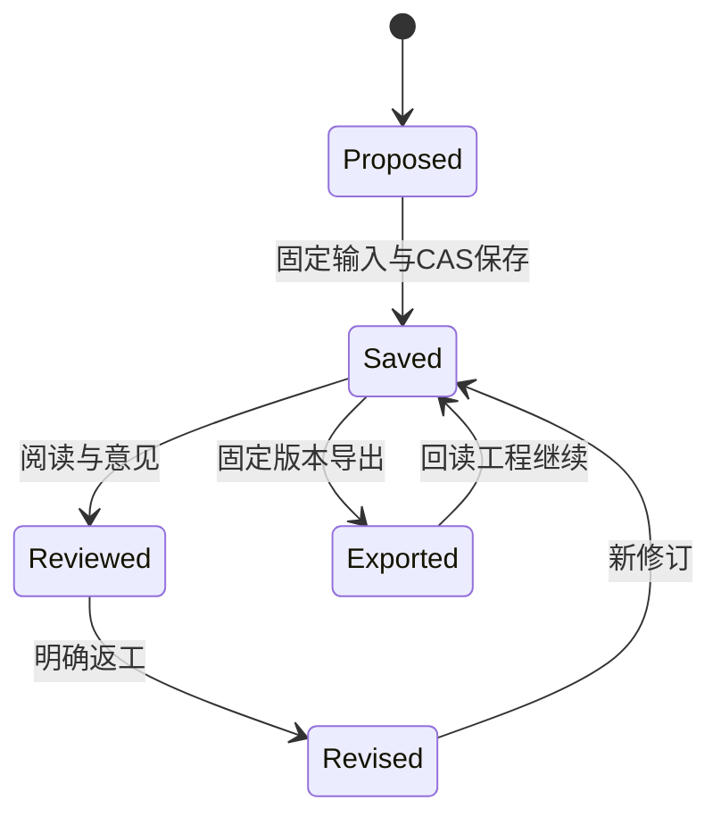

# 领域与本体设计

## 领域边界

宿主拥有图片原字节、来源、人物身份及正式选用。本包selected仅为专业方案偏好，不选用宿主素材；不能由色板对比度证明审美、人物一致性或素材权利。使用实际PNG/JPEG，完整解码由界面验收证明；不自动联网抓图或付费生成。

| Owner | 拥有的事实 |
| --- | --- |
| 河图Core | WorkRef、固定来源、专业对象修订、CAS、原操作、正式正文及作者决定 |
| 本插件 | 专业结构、计算、专业偏好、视图与可再生成导出 |
| 外部Agent | 理解、规划、内容生成与方法执行 |
| 作者 | 取舍、采纳、定稿、内容外发和费用决定 |

## 核心本体

| 对象 | 存储集合 | 创作含义 |
| --- | --- | --- |
| reference | references | 图像参考 |
| board | boards | 参考板 |
| palette | palettes | 色板 |
| design | designs | 设计方案 |
| note | notes | 区域意见 |

所有局部ID只在当前专业工程中有意义；同名、同ID或相同版本号不能跨作品推定身份。引用正文时固定UTF-8字节区间与原引文；引用媒体时固定宿主素材修订和摘要。

## 关系与不变量

board N—N reference N—1 asset source；palette 1—N swatch；design N—N reference；note N—1 fixed reference。

每个集合ID唯一，外键必须存在；删除仍被使用的对象拒绝保存。全对象更新与细粒度动作遵循同一校验，不存在绕过领域规则的编辑入口。来源更新先说明影响，再明确建立新修订。专业选中状态不扩大成宿主选用或作者定稿。

## 领域推断的证据边界

完整固定图像摘要、PNG/JPEG格式、缺图及错误素材类型

归一化裁切和意见区域不越界，旧意见固定图像摘要

同一图片用于不同参考板不复制原素材

色值规范、WCAG相对亮度对比、相同色与黑白反例

离线HTML实际嵌入全部图像，无网络依赖且用户文本转义

## 专业对象状态

此状态图描述工作旅程，不新增重复的数据库状态机。正文采纳与定稿由宿主另行处理。
