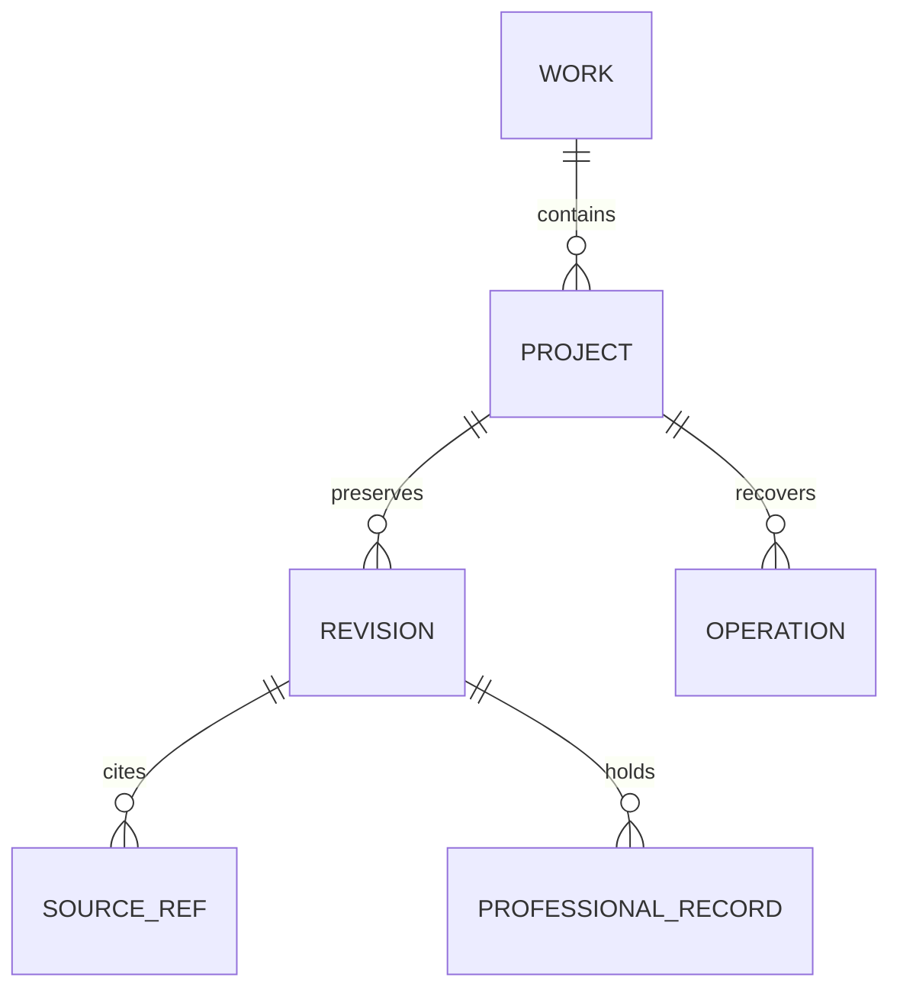
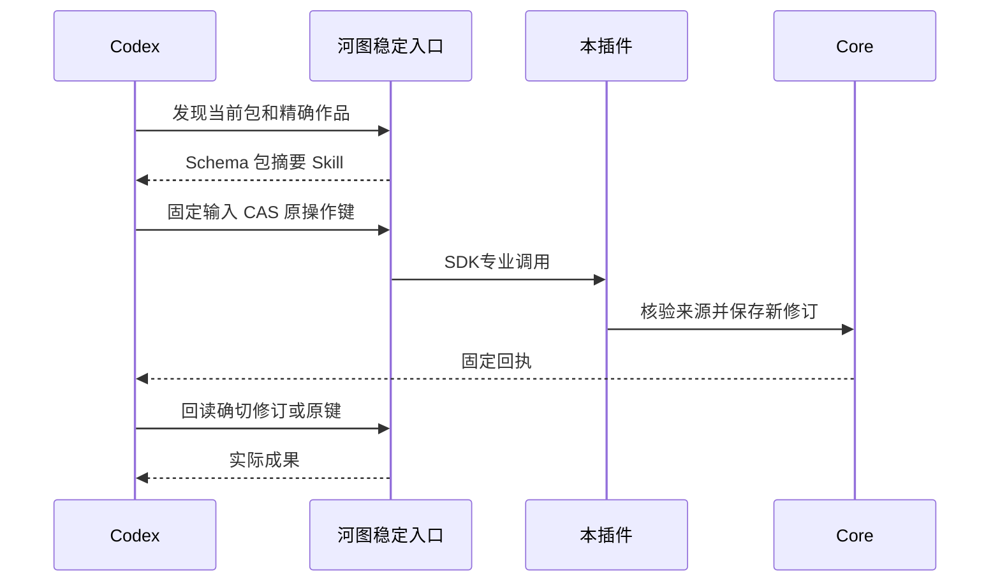

# 数据与API设计

## 数据格式

宿主包外壳按其Draft-07清单校验；专业数据与动作由Ajv2020独立校验，两者不混用。唯一可执行Schema是[包清单](../contracts/plugin-manifest.json)，`additionalProperties=false`拒绝拼错字段。`format_version=1`，Schema版本`1.0.0`；升级不得裁掉新字段覆盖旧数据。

| 根字段 | 类型 | 必填 |
| --- | --- | --- |
| format_version | constant | 是 |
| title | string | 是 |
| basis_refs | array | 是 |
| references | array | 是 |
| boards | array | 是 |
| palettes | array | 是 |
| designs | array | 是 |
| notes | array | 是 |

### 图像参考 `references`

| 字段 | 类型／范围 |
| --- | --- |
| id | `{"type":"string","minLength":1,"maxLength":100}` |
| title | `{"type":"string","minLength":1,"maxLength":200}` |
| asset_source_index | `{"type":"integer","minimum":0,"maximum":99}` |
| role | `{"enum":["reference","design"]}` |
| crop | `{"anyOf":[{"type":"object","additionalProperties":false,"properties":{"x":{"type":"number","minimum":0,"maximum":1},"y":{"type":"number","minimum":0,"maximum":1},"width":{"type":"number","minimum":0,"maximum":1},"height":{"type":"number","minimum":0,"maximum":1}},"required":["x","y","width","height"]},{"type":"null"}]}` |
| notes | `{"type":"string","minLength":0,"maxLength":4000}` |

### 参考板 `boards`

| 字段 | 类型／范围 |
| --- | --- |
| id | `{"type":"string","minLength":1,"maxLength":100}` |
| title | `{"type":"string","minLength":1,"maxLength":200}` |
| purpose | `{"type":"string","minLength":0,"maxLength":4000}` |
| reference_ids | `{"type":"array","items":{"type":"string","minLength":1,"maxLength":100},"maxItems":100}` |

### 色板 `palettes`

| 字段 | 类型／范围 |
| --- | --- |
| id | `{"type":"string","minLength":1,"maxLength":100}` |
| title | `{"type":"string","minLength":1,"maxLength":200}` |
| swatches | `{"type":"array","items":{"type":"object","additionalProperties":false,"properties":{"id":{"type":"string","minLength":1,"maxLength":100},"name":{"type":"string","minLength":1,"maxLength":100},"hex":{"type":"string","pattern":"^#[0-9A-Fa-f]{6}$"},"role":{"type":"string","minLength":0,"maxLength":200}},"required":["id","name","hex","role"]},"maxItems":50}` |

### 设计方案 `designs`

| 字段 | 类型／范围 |
| --- | --- |
| id | `{"type":"string","minLength":1,"maxLength":100}` |
| title | `{"type":"string","minLength":1,"maxLength":200}` |
| kind | `{"enum":["character","costume","location","prop"]}` |
| entity_ref | `{"anyOf":[{"type":"string","minLength":1,"maxLength":100},{"type":"null"}]}` |
| reference_ids | `{"type":"array","items":{"type":"string","minLength":1,"maxLength":100},"maxItems":100}` |
| palette_id | `{"anyOf":[{"type":"string","minLength":1,"maxLength":100},{"type":"null"}]}` |
| requirements | `{"type":"array","items":{"type":"string","minLength":1,"maxLength":4000},"maxItems":100}` |
| status | `{"enum":["proposed","selected"]}` |

### 区域意见 `notes`

| 字段 | 类型／范围 |
| --- | --- |
| id | `{"type":"string","minLength":1,"maxLength":100}` |
| reference_id | `{"type":"string","minLength":1,"maxLength":100}` |
| asset_sha256 | `{"type":"string","pattern":"^[a-f0-9]{64}$"}` |
| region | `{"type":"object","additionalProperties":false,"properties":{"x":{"type":"number","minimum":0,"maximum":1},"y":{"type":"number","minimum":0,"maximum":1},"width":{"type":"number","minimum":0,"maximum":1},"height":{"type":"number","minimum":0,"maximum":1}},"required":["x","y","width","height"]}` |
| comment | `{"type":"string","minLength":1,"maxLength":8000}` |
| status | `{"enum":["open","resolved"]}` |
| resolution | `{"type":"string","minLength":0,"maxLength":4000}` |

## 数据库与持久化

本包不新增SQLite或第二个作品数据库。使用公开SDK的ProjectStore保存`art_direction`专业对象。宿主保存不可变修订，插件只提交内容和固定来源。

| 逻辑记录 | 主键／关系 | 维护Owner |
| --- | --- | --- |
| 专业对象 | WorkRef＋Owner＋object_id | Core |
| 专业修订 | object_id＋revision，sha256，previous_sha256 | Core |
| 操作回执 | 工作区＋Owner＋operation_key | Core |
| 专业内容 | 上述根对象及集合局部ID | 本包 |
| 来源／专业依据 | 固定WorkRef、修订与摘要 | 原Owner |

## 公开API

Codex先调用河图实际能力发现，再用`hetu.plugins.capabilities`取得本包Schema和摘要，最终通过`hetu.plugins.invoke`调用。绑定精确WorkRef、management_ref、plugin_id、package_sha256及capabilities_sha256；不将路径或标题当身份。

| 动作 | 用途 | 效果 |
| --- | --- | --- |
| list_projects | 查找专业工程 | read |
| get_project | 读取固定专业工程 | read |
| save_project | 保存专业工程 | managed_write |
| put_reference | 维护图像参考 | managed_write |
| remove_reference | 移除图像参考 | managed_write |
| put_board | 维护参考板 | managed_write |
| remove_board | 移除参考板 | managed_write |
| put_palette | 维护色板 | managed_write |
| remove_palette | 移除色板 | managed_write |
| put_design | 维护设计方案 | managed_write |
| remove_design | 移除设计方案 | managed_write |
| put_note | 维护区域意见 | managed_write |
| remove_note | 移除区域意见 | managed_write |
| check_designs | 检查素材与设计关联 | read |
| palette_contrast | 计算色板对比度 | read |
| render_board | 读取实际参考板 | read |
| export_board | 导出离线参考板 | read |
| compare_designs | 比较两份造型方案 | read |
| locate_reference | 定位固定参考与区域意见 | read |
| get_source | 读取固定来源 | read |
| get_basis | 读取固定专业依据 | read |
| compare_versions | 比较固定修订 | read |
| export_project | 导出固定专业报告 | read |
| build_context | 准备有界创作上下文 | read |
| create_handoff | 准备精确AI交接 | read |
| get_operation | 回读原操作 | read |

逐字段参数归清单，生成的[功能清单](../CAPABILITIES.md)和[方法操作地图](../skills/hetu-art-direction/references/operations.md)提供导航。

## 写入与错误

新建使用expected_revision=0和空expected_sha256；更新使用回读的确切修订和摘要，所有写入携带原operation_key。同键同输入回读原成果，同键不同输入拒绝；冲突保留输入。错误包括invalid_input、revision_conflict、idempotency_conflict、not_found和hetu.budget_exceeded，以实际宿主回执为准。

导出按固定对象分块，核对offset、总长度、分块与完整SHA-256。UTF-8分块不能切断字符，二进制不经字符串转码。

设计的entity_ref与entity_source_index必须同时为空或同时给出；来源须为当前作品固定blueprint，通过公开sources.inspect核验具体实体及类型。不能以同名人物推定身份，专业方案不改正式实体。
